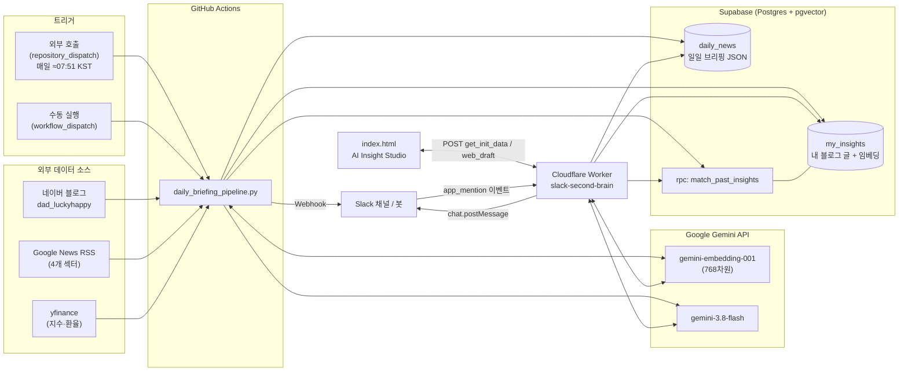
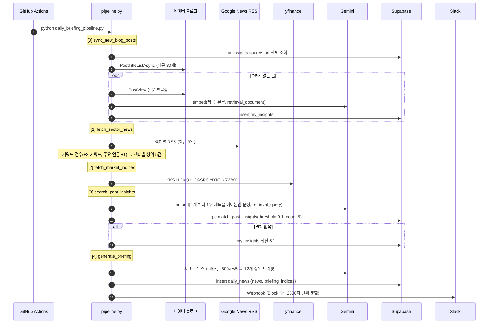
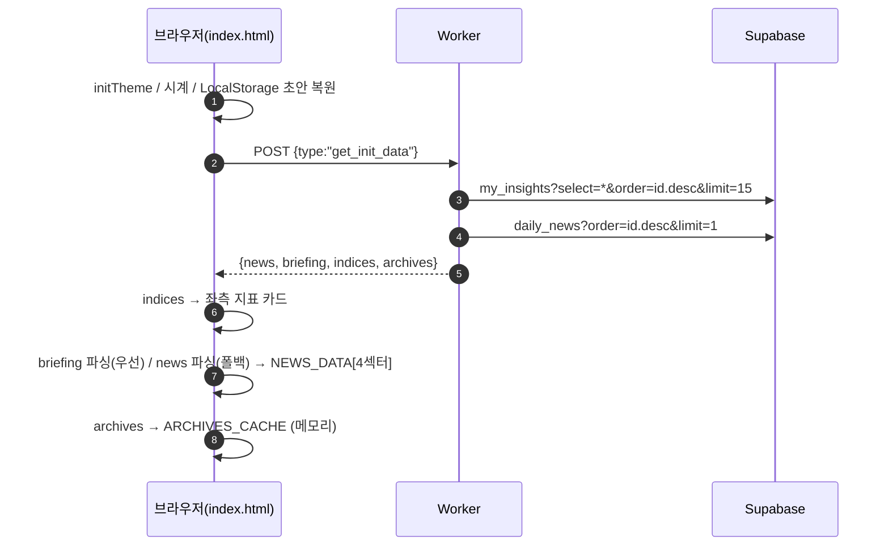
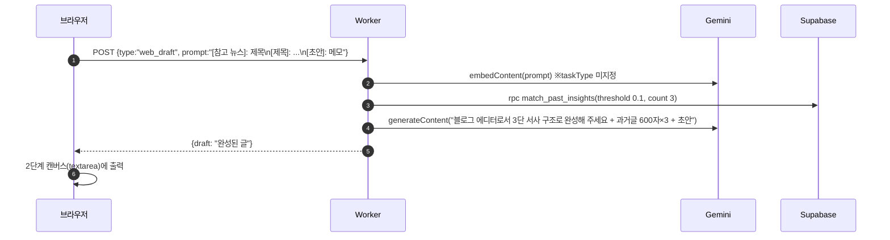

# dad_luckyhappy AI Insight Studio — 아키텍처 문서

> 작성일: 2026-11-17 · 분석 대상: `index.html`, `daily_briefing_pipeline.py`, `daily_briefing.yaml`, Cloudflare Worker(`slack-second-brain`), Supabase 테이블 export(`my_insights`, `daily_news`)

---

## 1. 한눈에 보기

이 시스템은 **"배치로 미리 만들어 두고, 웹은 읽기만 한다"** 는 구조입니다.

- **아침 배치(GitHub Actions + Python)** 가 뉴스·지표·내 과거 글을 모아 Gemini로 브리핑을 만들고, Supabase에 저장 + Slack으로 발송합니다.
- **Cloudflare Worker** 가 유일한 백엔드 API입니다. 웹페이지와 Slack 봇 양쪽의 요청을 받아 Supabase 조회, 임베딩, RAG 검색, Gemini 호출을 대신 수행합니다. (API 키는 모두 Worker에만 존재)
- **웹페이지(index.html)** 는 단일 정적 파일로, 페이지 로드 시 Worker에서 "오늘의 데이터"를 한 번에 받아 3단 화면(뉴스 / 에디터 / 아카이브)에 뿌립니다.



---

## 2. 구성 요소

| 계층 | 구성 요소 | 역할 | 실행 시점 |
|---|---|---|---|
| 스케줄러 | `daily_briefing.yaml` | Python 파이프라인 실행. `schedule:` 이 없고 `repository_dispatch(trigger-briefing)` 로만 돌아감 → 외부(크론 서비스 등)가 매일 호출 | 매일 22:51 UTC(= 07:51 KST)경 |
| 배치 | `daily_briefing_pipeline.py` | 블로그 증분 수집, 뉴스·지표 수집, RAG, 브리핑 생성, DB 적재, Slack 발송 | 위 트리거 시 |
| API | Cloudflare Worker | 웹/Slack 요청 라우팅, Supabase·Gemini 프록시 | 요청 시 |
| 저장소 | Supabase | `my_insights`(지식 베이스), `daily_news`(일일 스냅샷), `match_past_insights`(벡터 검색 RPC) | 상시 |
| 프론트 | `index.html` | Tailwind CDN 기반 단일 페이지, LocalStorage 초안 저장 | 사용자 접속 시 |
| 알림 | Slack | 아침 브리핑 수신 + `@봇` 멘션으로 초안 요청 | 상시 |

---

## 3. 데이터 모델 (Supabase)

### 3.1 `my_insights` — "내 관점" 지식 베이스 (74행)

| 컬럼 | 실제 사용 | 비고 |
|---|---|---|
| `id`, `created_at`, `updated_at` | ✅ | |
| `category` | 항상 `GENERAL` | 분류 미사용 |
| `title` | ✅ | 15건이 `&quot;` 등 HTML 엔티티가 디코딩되지 않은 상태로 저장 |
| `content_final` | ✅ | 네이버 본문 전체 텍스트 |
| `source_url` | ✅ | 증분 적재의 중복 키 (중복 0건) |
| `is_seed` | 항상 `true` | |
| `embedding` | ✅ vector(768) | 제목+본문 앞 2000자, `retrieval_document` |
| `summary` | ⚠️ 74건 중 68건 비어 있음 | 신규 적재분만 `"📌 관점: 본문 앞 120자..."` (실제 요약 아님) |
| `tags` | ⚠️ 고정값 `["#네이버블로그","#재테크인사이트"]` | 글마다 다른 태그 없음 |
| `view_tags` | ❌ 전부 `[]` | 웹의 "오늘의 뷰 태그"와 연결되지 않음 |

### 3.2 `daily_news` — 하루 1행 스냅샷 (30행)

`sector_news` (jsonb) 하나에 모든 걸 담습니다. **스키마가 세 번 바뀌었고 과거 행이 그대로 남아 있습니다.**

| 버전 | 행 id | `sector_news` 구조 |
|---|---|---|
| v1 | 1 | `{ "증시": "...", "부동산": "...", "비트코인/이더리움": "..." }` |
| v2 | 2–17 | `{ news: {...}, indices: {...} }` |
| v3 (현재) | 18–30 | `{ news: {증시, 가상자산, 부동산, AI}, briefing: "<Markdown 7천자 내외>", indices: {kospi, kosdaq, sp500, nasdaq, usdkrw} }` |

- `news.<섹터>`: `• 제목: ...\n  링크: ...\n  요약: ...` 형식의 평문 5건
- `briefing`: Gemini가 쓴 Markdown. 섹터별 `### ` 헤더 + `1. 📰 **뉴스 제목**: [제목](링크)` / `📌 **핵심 요약**` / `💡 **글감 제안 & 과거 관점**` 패턴
- `indices.<키>`: `{ val: "5,100.50", change: "-3.66% ▼" }` — **이미 문자열로 포맷된 값** (숫자 아님)
- id 2–18은 11/05 하루에 몰려 있음 → 개발 중 테스트 실행 흔적

### 3.3 `match_past_insights` (RPC)

입력 `query_embedding, match_threshold, match_count` → 유사 글 반환. 반환 컬럼은 `title`, `content_final`은 확실하나 **`source_url`은 반환하지 않는 것으로 보입니다** (근거: 브리핑 본문에 `[반도체 어디까지 상승할까요?](None)` 처럼 링크가 `None`으로 찍힘. 폴백 경로는 `source_url`을 select하므로 정상).

---

## 4. 주요 흐름

### 4.1 아침 배치 파이프라인



### 4.2 웹페이지 초기 로딩 (`get_init_data`)



- 이후 **아카이브 검색은 서버 호출 없이** `ARCHIVES_CACHE`(최근 15건)에서 제목·요약·태그 문자열 포함 검색만 합니다.
- 뉴스 카드 클릭 → `selectedNews`에 저장 → 중앙 "참고 박스"에 제목/링크/요약/글감 아이디어 표시.

### 4.3 "AI 3단 서사 첨삭" (`web_draft`)



### 4.4 Slack 멘션 초안 (`app_mention`)

Slack Events → Worker → 즉시 `200 OK` 반환 후 `ctx.waitUntil`로 비동기 처리 (재시도 헤더 `x-slack-retry-num` 있으면 무시). 흐름은 4.3과 동일하되 과거글 800자×3, 결과를 같은 스레드에 `chat.postMessage`.

---

## 5. Worker API 명세

모든 요청은 `POST /` + JSON body의 `type`(또는 `event.type`)으로 분기합니다.

| 요청 | 본문 | 응답 | 호출처 |
|---|---|---|---|
| `url_verification` | `{type, challenge}` | `{challenge}` | Slack (최초 등록) |
| `app_mention` | Slack Event 페이로드 | `OK` (결과는 Slack 스레드로) | Slack |
| `get_init_data` | `{type}` | `{news, briefing, indices, archives[]}` | 웹 |
| `web_draft` | `{type, prompt}` | `{draft}` | 웹 |
| 그 외 | — | `400 {error}` | |

필요한 Worker 환경 변수: `SUPABASE_URL`, `SUPABASE_KEY`, `GEMINI_API_KEY`, `SLACK_BOT_TOKEN`.
GitHub Secrets: `SUPABASE_URL`, `SUPABASE_KEY`, `GEMINI_API_KEY`, `SLACK_WEBHOOK_URL`.

---

## 6. 프론트엔드 구조 (`index.html`)

```
header   : 로고 · KST 시계 · 저장 상태 · 다크모드
main
├─ 좌 24% : 지표 카드 5개(indices) + 섹터 탭 4개 + 뉴스 카드 목록
├─ 중 52% : [참고 뉴스 박스] → [1단계 메모: 제목/메모/태그] → [2단계 결과 캔버스 + 복사 버튼 3개]
└─ 우 24% : 과거 관점 검색 (ARCHIVES_CACHE 필터)
```

| 전역 상태 | 내용 | 영속화 |
|---|---|---|
| `NEWS_DATA` | `{stock, crypto, realestate, ai}` 각 배열 `{id, sector, title, link, summary, idea}` | ❌ |
| `ARCHIVES_CACHE` | 최근 15건 `{id, date, title, summary, tags}` | ❌ |
| `selectedNews` | 선택한 뉴스 1건 | ❌ |
| 초안 `{title, memo, tags}` | 입력 400ms 디바운스 | ✅ `localStorage.dad_studio_draft` |
| 테마 | light/dark | ✅ `localStorage.dad_studio_theme` |
| 결과 캔버스 | AI 출력 | ❌ (새로고침 시 사라짐) |

브리핑 파싱 규칙: `###` 로 블록 분할 → 블록 텍스트에 `증시` / `가상자산·비트코인` / `부동산` / `AI·보안` 포함 여부로 섹터 결정 → `\d+\.\s*📰` 단위로 항목 분할 → 정규식으로 제목·링크·요약·글감 추출.

---

## 7. 현재 코드에서 확인된 이슈

실제 DB 데이터로 검증한 것과 코드 리딩으로 찾은 것을 구분했습니다.

> **2026-11-17 수정 반영** (`insight-studio/` 폴더): 7.1의 1·2번, 3번 중 제목 엔티티, 7.2의 taskType·컨텍스트 손실(요약 전달)·`select=*`·검색 범위(15→200)·단어 수·하드코딩 날짜·`innerHTML` 이스케이프·오류 처리. **미수정**: summary/tags/view_tags 백필, 섹터별 RAG 분리, threshold, Worker 인증·Slack 서명 검증, 복사 버튼 3종.

### 7.1 데이터로 확인된 버그

1. **섹터 오분류 → 탭이 비거나 덮어써짐** (`parseAndSetNewsData`)
   섹터 판별을 헤더가 아닌 **블록 전체 본문**의 `includes()`로 하고, `증시`를 가장 먼저 검사합니다. 가상자산/부동산 블록 본문에 "증시"·"가상자산" 같은 단어가 나오면 다른 섹터로 분류되어 앞의 섹터 데이터를 덮어씁니다.
   저장된 브리핑 13건을 같은 로직으로 돌려본 결과 **10건에서 최소 1개 섹터가 잘못 분류**됐습니다 (예: id 18 → 부동산·AI 블록이 모두 `crypto`로 분류, 부동산/AI 탭 빈 화면). 최신 행(id 30)은 우연히 정상.
   → 블록 첫 줄(헤더)만 보고 판별하거나, 헤더 이모지(📈🪙🏢🤖)로 판별하면 해결.

2. **브리핑의 과거 글 링크가 `(None)`**
   `match_past_insights` RPC가 `source_url`을 반환하지 않아 Python이 `None` 문자열을 프롬프트에 넣고, Gemini가 그대로 링크로 씁니다. → RPC 반환 컬럼에 `source_url` 추가.

3. **`my_insights` 메타데이터 공백**: summary 68/74건 비어 있음, tags 고정값, view_tags 미사용, 제목 15건 HTML 엔티티 미디코딩. 우측 "과거 관점 회상"이 사실상 제목 검색밖에 못 하는 원인입니다.

### 7.2 코드 리딩으로 확인된 사항

| 구분 | 내용 | 위치 |
|---|---|---|
| RAG 품질 | 배치는 4개 섹터 1위 제목을 **한 문장으로 합쳐** 임베딩 → 서로 다른 주제가 섞여 검색이 흐려짐. 섹터별로 따로 검색하는 편이 적합 | `search_past_insights` |
| RAG 품질 | 문서는 `retrieval_document`로 임베딩했는데 Worker 쿼리는 `taskType` 없이 임베딩 → 비대칭 검색 이점 상실 | Worker `web_draft`, Slack |
| RAG 품질 | `match_threshold: 0.1`은 사실상 필터 없음 | 전 구간 |
| 컨텍스트 손실 | `web_draft`에 선택 뉴스의 **제목만** 전달. 요약·글감 아이디어·링크·지표·태그는 서버에 안 감 | `runThreeStageRefiner` |
| 성능 | `get_init_data`가 `select=*`로 768차원 임베딩(행당 ~9.7KB)과 본문 전체까지 내려보냄 | Worker |
| 검색 범위 | 아카이브 검색 대상이 최근 15건뿐 (전체 74건) | Worker `limit=15` |
| 미구현 | "네이버 서식 복사"·"스레드 분할 복사"가 모두 `copyPlainText()` 호출. 단어 수(`word-count`) 갱신 안 됨 | `index.html` |
| 하드코딩 | 아카이브 날짜 폴백 `'2026-11-06'` | `fetchInitDataFromWorker` |
| 보안 | Worker에 인증이 없고 CORS `*` → URL을 아는 누구나 `web_draft`로 Gemini 쿼터 소모 가능. Slack 요청 서명(`X-Slack-Signature`) 검증 없음 | Worker |
| 보안 | Gemini 응답·뉴스 제목을 `innerHTML`로 삽입 (`item.title`, `item.link`) → 외부 텍스트에 HTML이 섞이면 그대로 실행 | `switchSector`, `selectNewsCard`, `renderArchiveList` |
| 견고성 | `fetchInitDataFromWorker` 실패 시 콘솔 경고만, 화면은 `-` 그대로. Gemini 응답 `candidates` 없을 때(안전 필터 등) 빈 문자열만 반환 | 웹·Worker |
| 하위 호환 | v1 행(`비트코인/이더리움` 키)은 현재 폴백 파서가 읽지 못함 (최신 1행만 쓰므로 현재는 무해) | Worker/웹 |

---

## 8. 설계 의도와의 간극 — "글을 대신 써주지 않는 도구"

목표는 **AI가 완성글을 쓰지 않고, 기초 자료 지원과 첨삭만** 하는 것입니다. 현재 구조와 비교하면:

| 목표 기능 | 현재 상태 |
|---|---|
| 기초 자료 지원 | ✅ 뉴스 큐레이션·지표·글감 제안은 잘 갖춰져 있음. 다만 배치에서 **하루 1회** 만들어진 결과를 보여줄 뿐, 내가 쓰는 주제에 맞춘 자료(관련 과거 글, 추가 수치, 반론)를 그때그때 찾아주는 경로는 없음 |
| 과거 관점 회상 | ⚠️ 최근 15건 문자열 검색. 이미 있는 임베딩/RPC를 웹에서 쓰지 않음 |
| 첨삭 | ❌ `web_draft` 프롬프트가 "3단 서사 구조로 **완성해** 주세요"라서 실질적으로 **AI가 글을 새로 씀**. 사용자 메모(60~70%)가 어디가 어떻게 바뀌었는지 알 수 없음 |
| 내 문체 유지 | ❌ 과거 글은 "내용 참고"로만 들어가고, 문체·말투 기준으로 쓰이지 않음 |

따라서 다음 단계 설계는 `web_draft`를 **"생성"이 아닌 "진단/제안" API**로 바꾸는 방향이 자연스럽습니다. 예:

- `type: "research"` — 주제/메모를 받아 관련 과거 글(링크 포함), 관련 뉴스, 확인이 필요한 수치를 반환
- `type: "review"` — 원문은 건드리지 않고 `[{문장 위치, 문제 유형(사실확인/논리비약/구조/문체), 코멘트, 제안}]` 형태의 JSON 첨삭 반환 → 웹에서 하이라이트 + 수락/거절 UI
- `type: "outline_check"` — 3단 서사(도입/근거/관점) 중 빠진 단계를 지적만 하고 채우지 않음

이 경우 응답이 구조화(JSON)되어야 하므로 Gemini 호출에 `responseMimeType: "application/json"` + 스키마 지정을 쓰는 것을 권장합니다.
