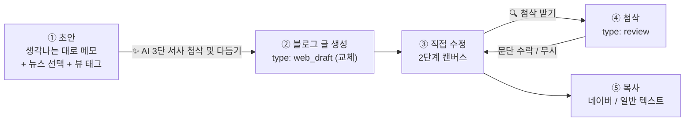

# AI 글 다듬기 & 첨삭 기능 설계 (v0.2)

> 작성일: 2026-11-17 · 상태: **결정 반영 완료, 구현 대기**
> 관련: [ARCHITECTURE.md](ARCHITECTURE.md) 8절 "설계 의도와의 간극"

---

## 0. 결정 사항 (2026-11-17)

| # | 질문 | 결정 |
|---|---|---|
| 1 | 기존 "AI 3단 서사 첨삭 및 다듬기" 버튼 | **유지하되 백엔드 로직을 교체.** 생각나는 대로 쓴 초안을 넣으면 **내 기존 글의 구조와 문체를 참고해** 블로그 글로 만들어 주고, 글 하단에 **해시태그**를 붙임 |
| 2 | 첨삭 수정안 범위 | **문단 단위** 수정안 허용 |
| 3 | 첨삭 중점 항목 | **논리·구조, 내 문체 일관성, 가독성** (사실·수치 확인은 제외) |
| 4 | Worker 남용 방지 | **Cloudflare Rate Limiting** |

---

## 1. 문제와 원칙

### 지금의 문제
지금 `web_draft` 프롬프트는 "3단 서사 구조로 완성해 주세요" 한 줄과 과거 글 3편 발췌가 전부입니다. 2026-11-17 테스트에서 한 줄 메모를 넣었더니 **2,610자 글**이 나왔습니다. 그중 대부분은 메모에 없던 내용, 즉 AI가 새로 지어낸 내용이었습니다. 또 내 글의 실제 구조(이전글 링크, "저는 ~했는데요" 도입, 짧은 줄)를 따르라는 지시도 없습니다.

### 원칙
1. **내용은 내 초안에서만 나온다.** AI는 초안을 *정리하고 다듬을* 뿐, 초안과 선택한 뉴스에 없는 주장·수치·사례는 새로 만들지 않습니다. 초안에 빈 곳이 있으면 지어내지 않고 `[✍️ 보충 필요: ...]` 자리표시를 남깁니다.
2. **형식은 내 글에서 배운다.** 구조와 문체 기준은 지금까지 쓴 블로그 글 74편에서 가져옵니다(2절). 일반적인 "블로그 글쓰기" 규칙은 쓰지 않습니다.
3. **AI 비중을 보여준다.** 생성 결과의 문단마다 출처(초안을 다듬음 / AI가 연결 문장 추가)를 표시하고, 전체에서 AI 추가분의 비율을 보여줍니다.
4. **첨삭은 제안이고, 결정은 사람이 한다.** 첨삭 수정안은 문단 단위로 [수락]/[무시]하며, 수락할 때만 반영됩니다.

---

## 2. 내 글의 기준선 (my_insights 74편 분석)

| 항목 | 값 | 사용처 |
|---|---|---|
| 글 길이 | 평균 2,358자 (1,187~4,222) | 생성 목표 길이. 단, **초안 분량의 2.5배를 넘지 않게** 제한 |
| 줄 길이 | 평균 35자 | 모바일 기준으로 짧게 줄바꿈 |
| 어미 | `~습니다/~ㅂ니다` 49% · `~요` 13%(`~는데요` 8%, 질문형 `~신가요/~을까요`) · 반말 `~한다/~이다` 3% · 어미 없는 줄 35% (2026-11-18 재분석, 5,161문장. 처음 표기한 "~다 53%"는 `~합니다`를 `~다`로 잘못 센 값) | 생성은 합쇼체 기본, 첨삭은 반말 평서형이 10%를 넘으면 지적 |
| 도입 | "저는 ~했는데요." / "이전 글에서 ~" | 개인 맥락으로 시작 |
| 연결 글 | "이전글" 99회 · "관련글" 15회 | RAG로 찾은 과거 글을 `이전글 :` / `관련글 :` 형식으로 삽입 (링크 포함) |
| 독자 호칭 | "여러분" 61회 · "개인적으로" 34회 | 결론에서 독자에게 말을 건네고 개인 관점을 밝힘 |
| 이모지 | 본문 0회 | 쓰지 않음 |

1단계에서는 이 표를 프롬프트에 고정값으로 넣습니다. 4단계에서 파이프라인이 주기적으로 다시 계산해 `style_profile`로 저장합니다.

---

## 3. 사용 흐름



| 단계 | 화면 | 바뀌는 것 |
|---|---|---|
| ① 초안 | 기존 1단계 그대로 | — |
| ② 생성 | 기존 버튼 그대로 | 백엔드 로직 교체(4.1). 결과 위에 "AI 추가 비율"과 `[✍️ 보충 필요]` 개수 표시 |
| ③ 수정 | 2단계 캔버스(편집 가능) | 본문도 LocalStorage에 자동 저장 |
| ④ 첨삭 | 캔버스 아래 **"🔍 첨삭 받기"** 버튼 + 코멘트 패널 | 신규(4.2) |
| ⑤ 복사 | 기존 복사 버튼 | 아직 `[✍️ 보충 필요]`가 남아 있으면 경고 |

---

## 4. API 설계 (Cloudflare Worker)

공통: Gemini 호출에 `generationConfig.responseMimeType = "application/json"` + `responseSchema`를 지정해 **JSON으로만** 받습니다. Worker가 JSON을 검증한 뒤 화면에 맞게 조립합니다.

### 4.1 `type: "web_draft"` — 초안 → 내 스타일 블로그 글 (로직 교체)

요청은 지금 형식(`prompt` 문자열)에서 구조화된 필드로 바꿉니다. 기존 형식도 당분간 받아 줍니다.
```json
{ "type": "web_draft", "title": "...", "memo": "생각나는 대로 쓴 초안", "tags": "#금리 #재개발",
  "news": { "title": "...", "summary": "...", "link": "..." } }
```

Worker 처리
1. 메모와 제목을 임베딩(RETRIEVAL_QUERY)해 `match_past_insights`로 과거 글 상위 4편을 찾습니다(`source_url` 포함).
2. 그중 유사도 상위 2편은 **문체 샘플**로, 본문 앞 1,200자를 그대로 넣습니다.
3. 4편 모두 **연결 글 후보**로 제목과 URL을 넣습니다.
4. Gemini에 아래 스키마로 요청합니다.

Gemini 응답 스키마
```json
{
  "title": "다듬은 제목 (사용자 제목이 있으면 유지)",
  "paragraphs": [
    { "section": "intro | body | insight | outro",
      "text": "문단 본문 (줄바꿈 포함)",
      "origin": "draft | bridge",
      "draft_quote": "이 문단의 근거가 된 초안 원문 일부 (origin=draft일 때 필수)" }
  ],
  "related_posts": [ { "label": "이전글 | 관련글", "title": "...", "url": "...", "after_paragraph": 0 } ],
  "gaps": [ "보충 필요: 재개발 단계(관리처분 전/후)를 초안에 적지 않음" ],
  "hashtags": [ "#금리", "#재개발", "#조합원", "..." ]
}
```

프롬프트 핵심 규칙
- 초안과 선택 뉴스에 없는 사실, 수치, 사례, 고유명사는 추가하지 않습니다. 빈 곳은 `[✍️ 보충 필요: 무엇]`으로 남깁니다.
- `origin: "bridge"`는 문단 사이를 잇거나 도입·마무리의 형식적인 문장일 때만 쓰고, 문단 하나에 2문장 이하로 제한합니다.
- 구조: `intro`(개인 맥락, "저는 ~했는데요") → `body`(초안의 근거와 경험) → `insight`(내 관점: "개인적으로") → `outro`(여러분에게 건네는 말). 3단 서사는 intro/body/insight에 해당합니다.
- 문체: 2절 기준선을 따르고, 문체 샘플 2편의 말투를 흉내 냅니다.
- 해시태그: 사용자가 입력한 뷰 태그를 먼저 넣고, 본문 키워드로 채워 **총 8~12개**를 만듭니다. `#`으로 시작하고 띄어쓰기는 없앱니다.

Worker 후처리와 검증
- `draft_quote`가 초안의 부분 문자열이 아닌 `draft` 문단은 `bridge`로 다시 분류합니다. 공백은 정규화한 뒤 비교합니다.
- `related_posts`의 URL은 RAG 결과 안에 있는 것만 남깁니다(지어낸 링크 차단).
- 해시태그는 중복을 없애고 12개로 자릅니다.
- 최종 텍스트 조립: 제목 → 문단들(관련글은 지정 위치에 `이전글 :\n제목\nURL`) → 빈 줄 → 해시태그 한 줄.
- AI 추가 비율 = `bridge` 문단 글자 수 / 전체 글자 수.

응답
```json
{ "draft": "<조립된 최종 텍스트>",
  "meta": { "ai_ratio": 0.12, "gaps": ["..."], "hashtags": ["..."], "related_posts": [...],
            "paragraphs": [ { "origin": "draft", "chars": 210 }, ... ] } }
```
`draft` 필드는 그대로 두므로 지금의 화면과 Slack 봇도 계속 동작합니다.

### 4.2 `type: "review"` — 첨삭 (신규)

요청
```json
{ "type": "review", "title": "...", "body": "<캔버스의 현재 본문>", "memo": "<원래 초안>" }
```

응답 (Gemini 스키마 = Worker 응답)
```json
{
  "structure": {
    "intro":   { "status": "ok | weak | missing", "comment": "..." },
    "body":    { "status": "weak", "comment": "근거가 경험 한 가지뿐" },
    "insight": { "status": "missing", "comment": "그래서 나는 어떻게 하겠다는 결론이 없음" }
  },
  "comments": [
    { "id": "c1",
      "category": "logic | structure | style | readability",
      "severity": "high | medium | low",
      "target": "본문에서 그대로 인용한 문단 (전체 또는 일부)",
      "comment": "'무조건 손해'는 과한 일반화. 이전 글(공사비 인상...)에서는 사업 단계별로 다르다고 썼음",
      "suggestion": "문단 단위 수정안 (없으면 null)" }
  ],
  "style_notes": [ "이 문단만 해요체", "평균 줄 길이 58자 (평소 35자)" ]
}
```

| `category` | 보는 것 |
|---|---|
| `logic` | 비약, 과한 일반화, 근거와 결론 불일치, 초안과 다른 주장 |
| `structure` | 도입·근거·관점 배치, 문단 순서, 결론 누락 |
| `style` | 2절 기준선과의 차이(어미, 이모지, 호칭, 도입 패턴) |
| `readability` | 긴 줄·문장, 중복, 모호한 지시어, 문단 길이 |

Worker 검증
- `target`이 본문의 부분 문자열이 아니면 그 코멘트를 버립니다(위치를 알 수 없는 코멘트 차단).
- `suggestion`은 `target` 길이의 2배 이하만 허용합니다. 문단 단위 수정은 허용하되 새 내용으로 부풀리는 것은 막기 위해서입니다.
- 코멘트는 최대 10개, severity 순으로 정렬합니다.
- 문체 수치(줄 길이, 어미 비율, 글자 수)는 Gemini에 맡기지 않고 **Worker가 직접 계산**해 `style_notes`에 추가합니다.

### 4.3 남용 방지 (Rate Limiting)

`wrangler.toml`에 Workers Rate Limiting 바인딩을 추가합니다.
```toml
[[ratelimits]]
name = "AI_LIMITER"
namespace_id = "1001"
simple = { limit = 10, period = 60 }
```
- `web_draft`, `review` 요청에만 적용합니다. `get_init_data`(Gemini를 안 씀)와 Slack 이벤트에는 적용하지 않습니다.
- 키는 `CF-Connecting-IP`. 초과하면 `429 {error: "잠시 후 다시 시도해 주세요"}`를 돌려주고, 화면에는 토스트로 표시합니다.

---

## 5. 프론트엔드 변경 (`index.html`)

| 영역 | 변경 |
|---|---|
| ✨ 버튼 | 요청을 구조화 필드(`title, memo, tags, news`)로 보냄. 응답 `meta`로 배지 표시: "AI 추가 12% · 보충 필요 2곳" |
| 2단계 캔버스 | 생성 결과 + 직접 수정. 본문도 LocalStorage에 저장(`dad_studio_body`) |
| 🔍 첨삭 받기 | 캔버스 아래 새 버튼. 결과는 캔버스 아래 **첨삭 패널**에 표시 |
| 첨삭 패널 | 상단에 구조 3칸 배지(도입·근거·관점 ✅/⚠️/❌), 아래에 코멘트 카드(카테고리 색, 지적, 수정안 미리보기, [수락] [무시] [위치 보기]) |
| 위치 보기 | `body.indexOf(target)`으로 위치를 찾아 `setSelectionRange`로 캔버스에서 해당 문단을 선택하고 스크롤 |
| 수락 | 본문의 `target`을 `suggestion`으로 바꾸고, 바뀐 글자 수를 AI 비율에 더함 |
| 복사 | `[✍️ 보충 필요` 문자열이 남아 있으면 "보충 필요 n곳이 남았습니다" 확인창 |

---

## 6. 단계별 구현 계획

| 단계 | 범위 | 변경 파일 |
|---|---|---|
| **1단계** | 4.1 `web_draft` 교체 + 4.3 Rate Limiting + 프론트 배지·본문 저장 | `worker/src/index.js`, `worker/wrangler.toml`, `index.html` |
| **2단계** | 4.2 `review` + 첨삭 패널 | 같음 |
| 3단계 | Supabase `drafts` / `draft_reviews` 테이블로 기기 간 저장과 첨삭 이력 | SQL 002, Worker, index.html |
| 4단계 | `style_profile` 자동 계산(파이프라인), Slack 봇 요청도 같은 로직으로 | pipeline.py, Worker |

1단계와 2단계는 같은 파일을 고치므로 순서대로 진행합니다. 단계마다 실제 초안 2~3개로 결과를 확인한 뒤 배포합니다.

---

## 7. 참고: 3단계 테이블 초안

```sql
create table public.drafts (
  id bigint generated always as identity primary key,
  created_at timestamptz default now(), updated_at timestamptz default now(),
  title text, memo text, body text, tags text[], news jsonb,
  status text default 'writing',     -- writing | reviewed | published
  ai_ratio real, published_url text
);
create table public.draft_reviews (
  id bigint generated always as identity primary key,
  draft_id bigint references public.drafts(id) on delete cascade,
  created_at timestamptz default now(),
  body_snapshot text, result jsonb, decisions jsonb
);
```
